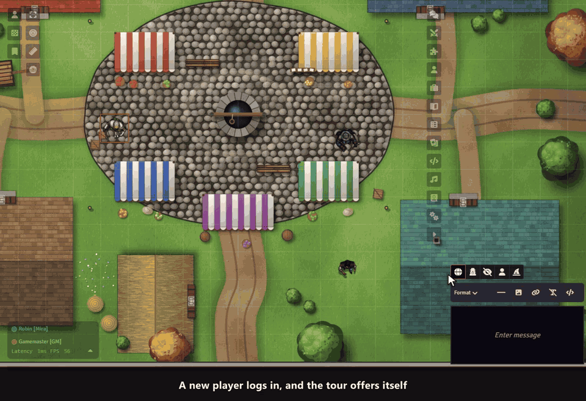

# Sephral’s First Table

**A new player joins your game and has no idea where to click. You are busy running the table, and nobody wants to explain the same things again.** First Table gives every new player a friendly first session of their own, started by itself at their first login, and a guide they can come back to for everything else in Foundry.

[](#install)
[](https://discord.gg/7BjCgDYaBP)
[](https://github.com/Sephral)



## Highlights

* **You do nothing.** A small card welcomes a new player at the first login and offers the first steps. No setup, no popup for you.
* **It waits for the player.** Every step goes on only after the player has really done it. The card rings the real button on screen, and a step can always be skipped or marked as seen.
* **Seven chapters.** Your first steps, the sidebar with every tab a player has, the scene controls on the left, the character sheet, chat and dice, fights and useful extras. Players pick any chapter or play it again from the question mark.
* **Teaches at the right moment.** When the first fight starts, and at the player's first turn, a short tip offers the fight chapter. Players who know the game are never nagged.
* **Made for your game system.** The sheet chapter speaks the language of D&D 5e, Pathfinder 2e, SWADE and Crucible, and any other system gets a general text. Only what a player can really use is shown.
* **Quiet and small.** One card in the corner, never in the way of the map. Fold it to a pill, drag it aside, stop whenever you like.
* **Your table, your chapters.** Leave out chapters or single steps, offer a chapter to a player yourself, and mark veterans as experienced.
* **You see who is where.** The overview shows every player with progress in each chapter.
* **English and German.** The guide speaks the language of each player.

Nothing is changed in your actors, scenes or chat. The module only remembers how far each player got.

## How it works

1. Enable the module in your world.
2. Players who log in for the first time get the offer and take the first chapter at their own speed.
3. Open the player overview from the module settings to see who got how far, or to offer a chapter to a player.

## Good to know

A world that is already in use starts with the offer switched to "only when I start it for a player", so your regulars are never surprised. You can change that in the settings.

## Install

First Table is not in Foundry's module search. Copy this link:

```text
https://github.com/Sephral/sephrals-first-table/releases/latest/download/module.json
```

1. In Foundry's setup screen open **Add-on Modules** and click **Install Module**.
2. Paste the link into **Manifest URL** at the bottom of the window.
3. Click **Install**, then enable the module in your world.

On The Forge open the Bazaar, click **Install From Manifest** and paste the link.


Foundry VTT 13 and 14 · any game system · English and German

## Learn more

Every setting and the macro API are explained in the [manual](MANUAL.md). Questions or ideas? Join us on [Discord](https://discord.gg/7BjCgDYaBP). Looking for more? See [all modules by Sephral](https://github.com/Sephral).

## License

See [LICENSE.md](LICENSE.md).
